<p align="center">
  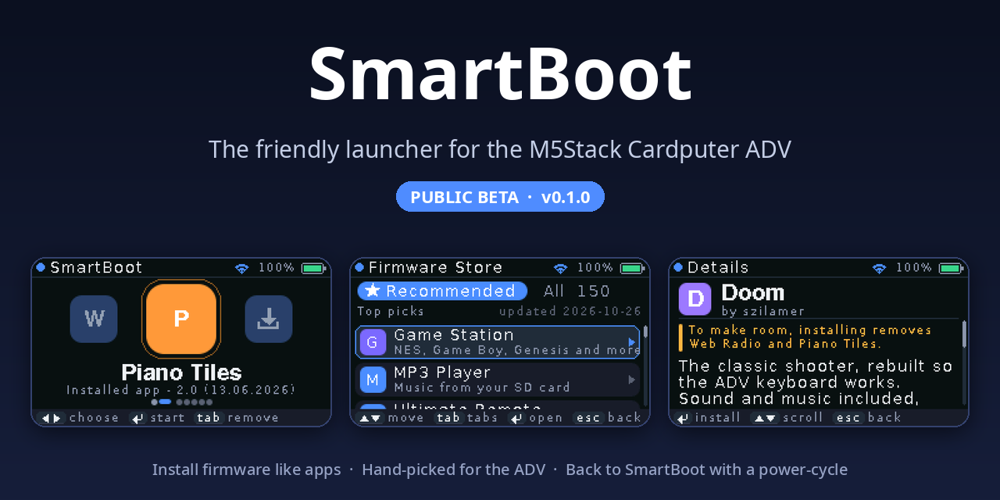
</p>

<p align="center">
  <a href="../../releases/latest"></a>
  
  
  <a href="LICENSE"></a>
</p>

**SmartBoot turns your M5Stack Cardputer ADV into a little app machine.** Browse a store of
community firmware, read what each one does in plain words, and install it with one press.
Installed firmware shows up as an app on your Home screen, next to the others. When you're done
playing, turn the Cardputer off and on and you're back in SmartBoot.

No partition tables, no offsets, no flashing tools. Just apps.

---

## Highlights

- **A store that explains itself.** A *Recommended* page with hand-picked firmware for the ADV,
  each with a short plain-language description and "good for" tags, plus the full community
  catalog of 150 popular Cardputer firmwares with search.
- **Firmware as apps.** Keep several apps installed side by side. They live on your Home screen as
  big tiles. Press Enter to start one, Tab to remove it.
- **Always a way back.** SmartBoot ships its own bootloader: every time you turn the Cardputer on,
  SmartBoot starts. Apps keep running across their own restarts and sleep, so nothing breaks while
  you use them.
- **Smart space management.** Before anything is installed, SmartBoot tells you exactly what will
  happen. *"It fits"*, *"To make room, installing removes Web Radio"*, or
  *"Game Station's storage shrinks to 3.0 MB"*. Game emulators get all the free space for games,
  and their storage grows back automatically when you delete other apps.
- **Install from your SD card.** A clean file browser that shows only folders and `.bin` files.
  SmartBoot reads each file before installing it and refuses files built for a different chip.
- **Built for the ADV.** Every recommended pick supports the Cardputer ADV's keyboard. Older
  firmware written for the original Cardputer often can't read it.
- **Your data stays yours.** Your Wi-Fi password and settings live in SmartBoot's own storage area,
  apart from installed apps. Downloads use a random device ID instead of your Cardputer's MAC address.
- **Safe installs.** Firmware is downloaded into free space and checked before the partition
  table is updated, so a failed download or a pulled plug never leaves a half-installed app behind.

---

## Screenshots

<table>
  <tr>
    <td>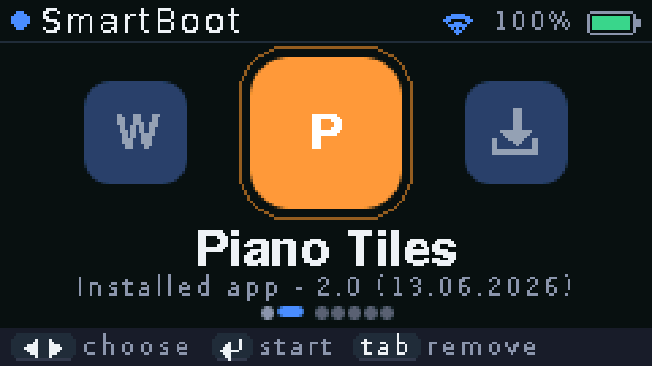</td>
    <td>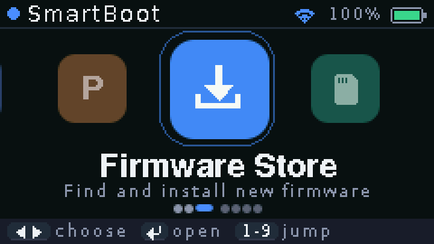</td>
  </tr>
  <tr>
    <td align="center"><b>Home.</b> Installed apps come first.</td>
    <td align="center">SmartBoot's own tiles: store, SD card, Wi-Fi, settings.</td>
  </tr>
  <tr>
    <td>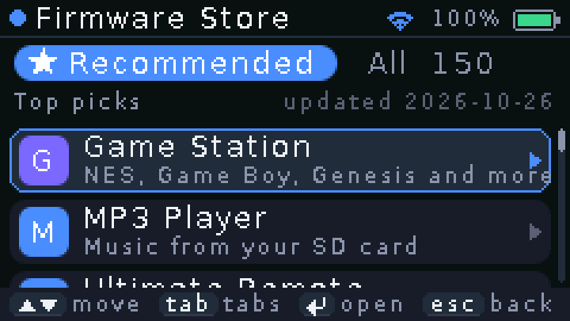</td>
    <td>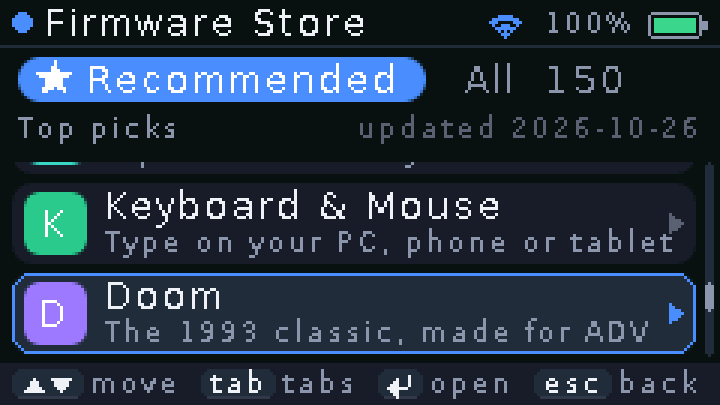</td>
  </tr>
  <tr>
    <td align="center"><b>Recommended.</b> Picks for every kind of user.</td>
    <td align="center">Games, music, coding, everyday tools and more.</td>
  </tr>
  <tr>
    <td>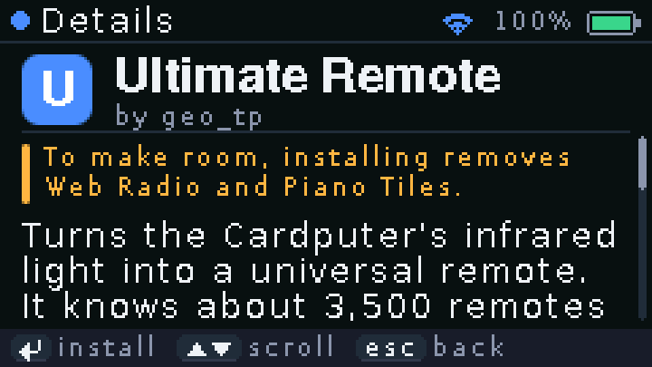</td>
    <td>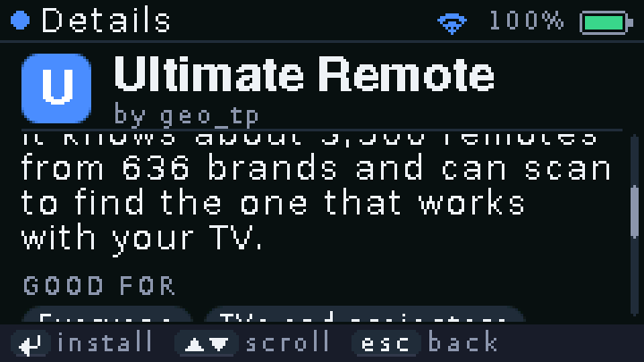</td>
  </tr>
  <tr>
    <td align="center"><b>Details</b> in plain words.</td>
    <td align="center">"Good for" tags, version and size.</td>
  </tr>
  <tr>
    <td>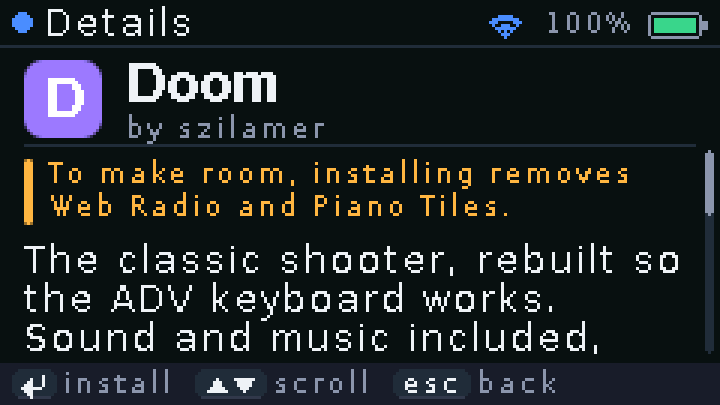</td>
    <td>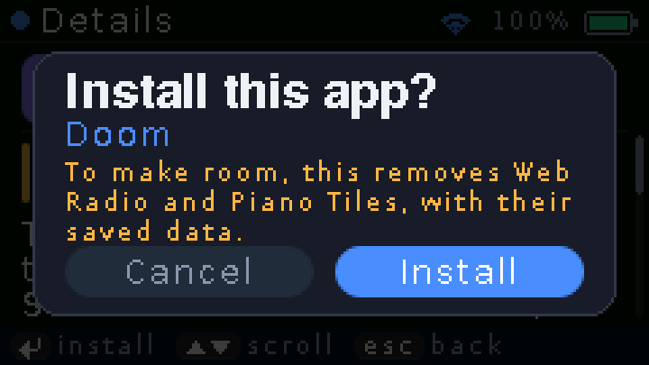</td>
  </tr>
  <tr>
    <td align="center"><b>No surprises.</b> You see what an install changes...</td>
    <td align="center">...and confirm it first.</td>
  </tr>
  <tr>
    <td>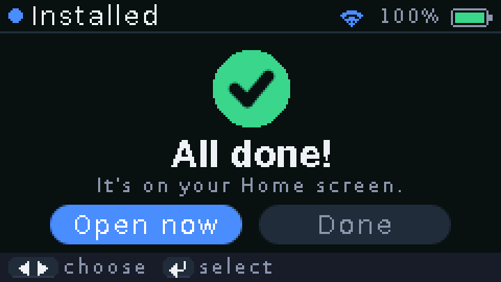</td>
    <td>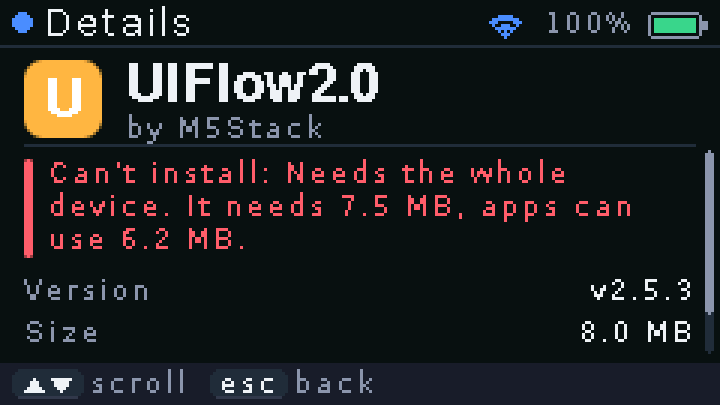</td>
  </tr>
  <tr>
    <td align="center"><b>Done</b>, and open it right away.</td>
    <td align="center">Firmware that can't fit says why.</td>
  </tr>
  <tr>
    <td>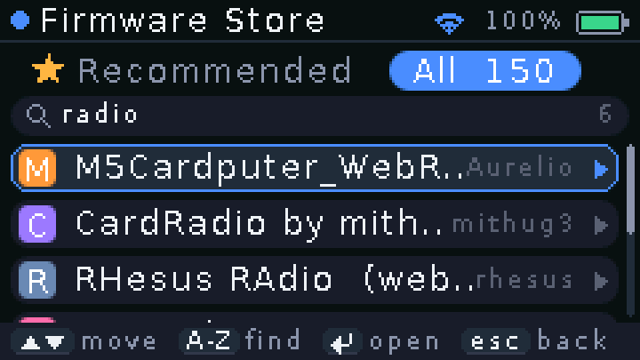</td>
    <td>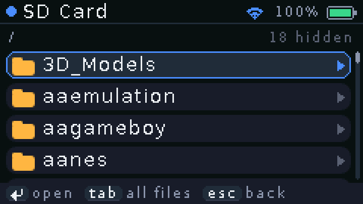</td>
  </tr>
  <tr>
    <td align="center"><b>Search</b> the whole catalog.</td>
    <td align="center"><b>SD card</b> browser: folders and firmware only.</td>
  </tr>
  <tr>
    <td>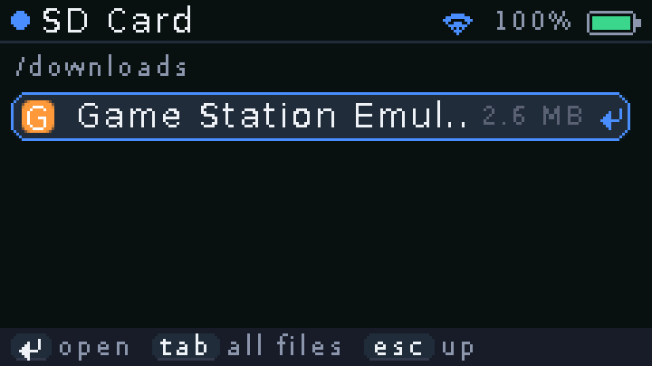</td>
    <td>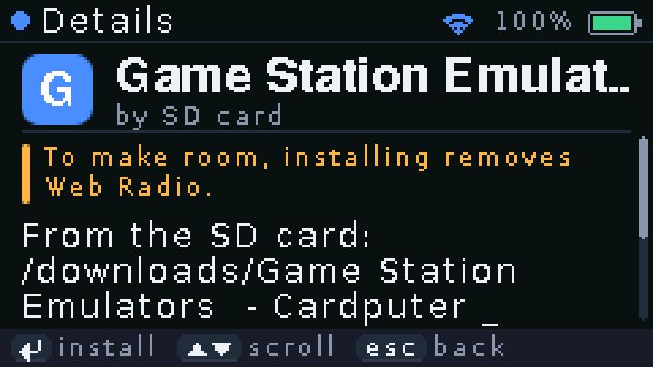</td>
  </tr>
  <tr>
    <td align="center">Pick a <code>.bin</code> file...</td>
    <td align="center">...and get the same clear install plan.</td>
  </tr>
  <tr>
    <td>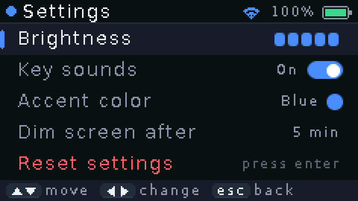</td>
    <td>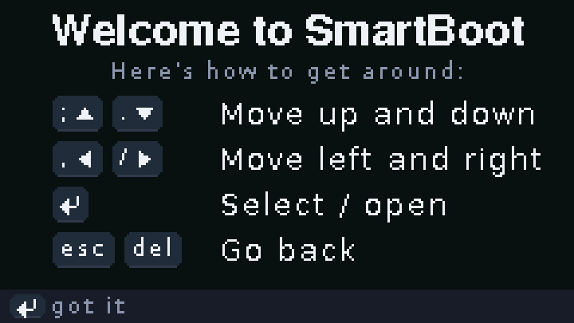</td>
  </tr>
  <tr>
    <td align="center"><b>Settings</b>: brightness, sounds, accent color, dimming.</td>
    <td align="center">A key guide on first start.</td>
  </tr>
</table>

---

## Why SmartBoot?

[M5Launcher](https://github.com/bmorcelli/Launcher) by bmorcelli pioneered installing firmware next to
a launcher, and SmartBoot builds on its work (see [Credits](#credits)). SmartBoot takes a different
direction: one device, done really well, for people who just want to use their Cardputer.

| | **SmartBoot** | M5Launcher |
|---|---|---|
| Made for | The Cardputer ADV, designed around its screen and keyboard | 40+ ESP32 devices |
| Home screen | Big app tiles, installed apps first | Text menus |
| Finding firmware | Hand-picked, ADV-compatible *Recommended* page with plain-language descriptions, plus the full catalog | Full catalog |
| Making room | Tells you in plain words which apps go or how much storage shrinks | You choose between partition options |
| Game storage (e.g. Game Station) | Grows and shrinks automatically as you add and remove apps | Set when installing |
| Wi-Fi password and settings | In SmartBoot's own storage area, apart from installed apps | In the settings area shared with apps |
| Device ID sent when downloading | A random ID | The Wi-Fi MAC address |
| Source code | Fully open (MIT), **including the bootloader** | Open, but its custom bootloader isn't in the public repository |
| Other devices, web interface | Not supported | Supported |

If you use one of the many other ESP32 devices, or want M5Launcher's web interface, M5Launcher is
a great choice. If you have a Cardputer ADV and want it to feel like a finished product,
try SmartBoot.

---

## Install

> **Heads-up:** installing SmartBoot replaces everything on the Cardputer: its current firmware,
> installed apps and settings. Files on the SD card are not touched. You can always go back to
> stock firmware later (see [FAQ](#faq)).

Download the files from the [latest release](../../releases/latest).

### Windows: double-click

1. Download **`SmartBoot-v0.1.0-beta-windows.zip`** and unzip it.
2. Connect the Cardputer ADV with a USB-C **data** cable and turn it on.
3. Double-click **`flash.bat`** and follow the instructions.

### Any computer: in the browser (Chrome or Edge)

1. Download **`SmartBoot-v0.1.0-beta.bin`**.
2. Open Espressif's web flasher: <https://espressif.github.io/esptool-js/>
3. Click **Connect** and pick the Cardputer's port.
4. Set the flash address to **`0x0`**, choose the `.bin` file and click **Program**.

### Command line (macOS, Linux, Windows)

```sh
pip install esptool
esptool --chip esp32s3 write_flash 0x0 SmartBoot-v0.1.0-beta.bin
```

If the Cardputer isn't found, hold the **G0** button while plugging it in and try again.

---

## Using SmartBoot

| Key | Does |
|---|---|
| `;` `.` | Move up and down |
| `,` `/` | Move left and right |
| `Enter` | Select or open |
| `Esc` or `Del` | Go back |
| `Tab` | Switch tabs, or remove the selected app on Home |
| Letters | Search the store, or jump to a file on the SD card |

- **Connect to Wi-Fi** from the Wi-Fi tile. The store loads its list as soon as you're online.
- **Install** by opening any firmware and pressing Enter. SmartBoot shows what the install will change first.
- **Start an app** by selecting its tile on Home and pressing Enter.
- **Come back to SmartBoot** by turning the Cardputer off and on.
- **Install from the SD card** with the SD Card tile. Put `.bin` files anywhere on a FAT32 card.

### How space works

SmartBoot itself uses about 1.8 MB of the Cardputer's 8 MB flash; installed apps share the other 6.2 MB.

- Most apps get a small storage area for their settings and files.
- Apps that ask for big storage, like **Game Station**, get all the free space. Installing another
  app shrinks it (never below 1 MB); when it's the only app left, it grows back.
- If something doesn't fit, SmartBoot names the apps that would be removed and asks first.

---

## Recommended apps

Every pick supports the Cardputer ADV according to its author, and the list is picked so there's something for everyone.

| App | What it's for | By |
|---|---|---|
| Game Station | NES, Game Boy, SNES, Genesis and more | geo_tp |
| MP3 Player | Music from your SD card | sanchitminda |
| Ultimate Remote | A universal remote for almost any TV | geo_tp |
| MicroPython Shell | Write and run Python code | BeanpieChen |
| Piano Tiles | Rhythm game with 54 songs | Zeloksa |
| Cardputer ABC | Letters and sounds for toddlers | fancyoung |
| Web Radio | Thousands of internet radio stations | halbeshuhn |
| Chess | Play the computer or a friend | beatsforthemind |
| MiniAcid | A pocket techno groovebox | urtubia |
| Keyboard & Mouse | Type and point on your PC, phone or tablet | jayden_sudo |
| Doom | The 1993 classic, rebuilt for the ADV keyboard | szilamer |
| Voice Recorder | Voice notes to the SD card | Moskic |
| Bruce | Radio and network toolkit for tinkerers | BruceDevices |
| User Demo | M5Stack's hardware test | M5Stack |

All firmware comes from its authors through [LauncherHub](https://launcherhub.net) and M5Stack's
download server. SmartBoot doesn't host or change it.

---

## Open source

SmartBoot is **fully open source under the [MIT license](LICENSE)**: every part of it, from the app and its
install engine to the custom bootloader and the build tools. Study it, improve it, or use any part in
your own projects. That includes the bootloader ([`bootloader/`](bootloader)), which M5Launcher
doesn't publish.

This is a **beta**: expect a few rough edges. Found a bug or have an idea? Please
[open an issue](../../issues). Pull requests are welcome too.

### Build from source

You need [PlatformIO](https://platformio.org) and a Cardputer ADV connected over USB.

```sh
git clone https://github.com/MINIsmaja/SmartBoot.git
cd SmartBoot
tools/flash.sh --table      # first time: bootloader + partition table + SmartBoot
tools/flash.sh              # later: update SmartBoot, keep installed apps
tools/release.sh            # build the release files into dist/
```

See [docs/DEVELOPING.md](docs/DEVELOPING.md) for how it fits together: the boot rule, the partition
layout, the install engine and the dev console.

---

## FAQ

**Can SmartBoot brick my Cardputer?**
No. The ESP32-S3 can always be re-flashed over USB: hold **G0** while plugging it in, then flash
SmartBoot or any other firmware again.

**How do I go back to the stock firmware?**
Flash M5Stack's *Cardputer-Adv User Demo* or *UIFlow2* with [M5Burner](https://docs.m5stack.com/en/download).
(You can also keep SmartBoot and install the User Demo as an app from its store.)

**Does it work on the original Cardputer?**
SmartBoot is built and tested for the Cardputer ADV only.

**Why can't I install UIFlow2?**
It needs the whole 8 MB on its own. SmartBoot tells you this before anything is changed.

**Is the Wi-Fi 5 GHz?**
No, the Cardputer supports 2.4 GHz Wi-Fi only.

---

## Known limitations (beta)

- Opening a firmware's details takes a few seconds while it checks the download.
- The store's *All* tab shows the 150 most popular Cardputer firmwares, and not all of them support the ADV.
  The *Recommended* tab only lists ADV-compatible ones.
- Firmware that needs a separate data file download isn't supported yet (none of the popular ones do).

---

## Credits

- **[M5Launcher](https://github.com/bmorcelli/Launcher)** by bmorcelli: SmartBoot's partition and
  install engine is ported from it (MIT License). Thank you!
- **[LauncherHub](https://launcherhub.net)**: the community firmware catalog the store uses.
- **Every firmware author** whose work makes the store worth opening.
- **M5Stack** (M5Unified, M5GFX, M5Cardputer) and **Espressif** (ESP-IDF, Arduino for ESP32, esptool).
- **Built with AI:** SmartBoot was developed with the help of AI (Anthropic's Claude), and tested
  on a real Cardputer ADV.

Third-party licenses are listed in [THIRD_PARTY_NOTICES.md](THIRD_PARTY_NOTICES.md).

## License

SmartBoot is released under the [MIT license](LICENSE). Code ported from M5Launcher keeps its MIT
notice, and the bootloader file from ESP-IDF keeps its Apache-2.0 header.

SmartBoot is an independent project and isn't affiliated with M5Stack.
